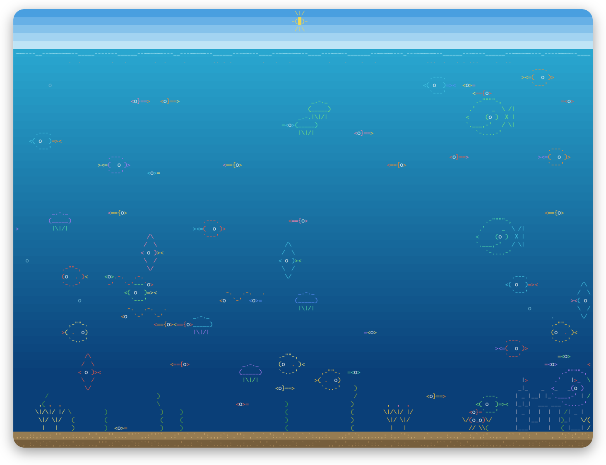
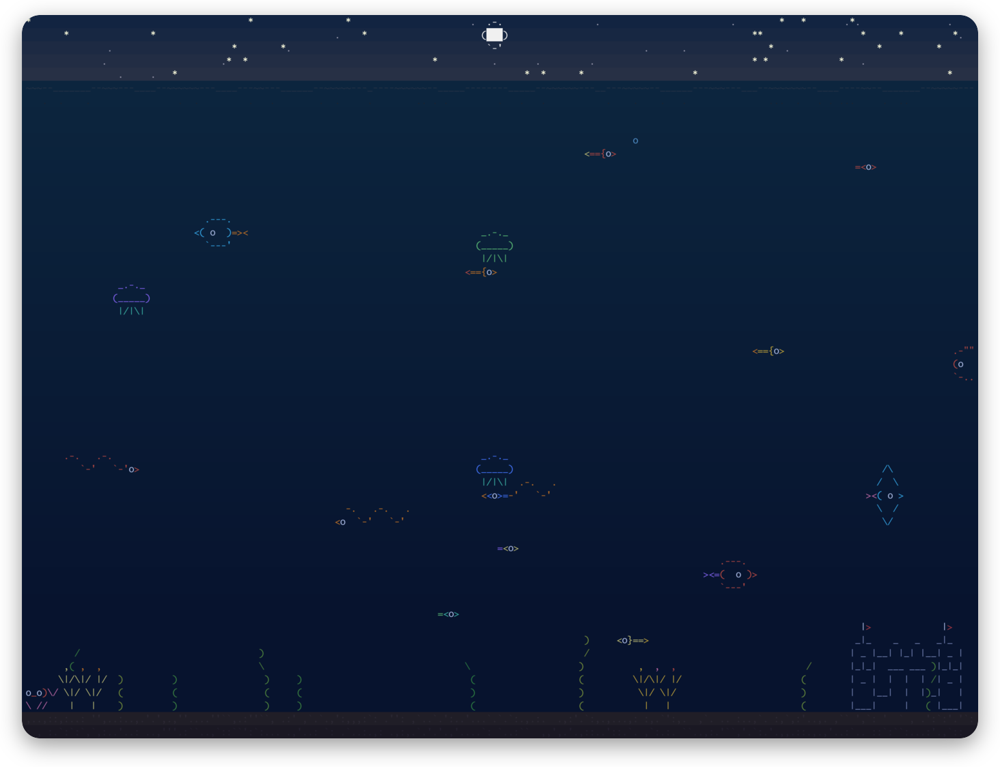
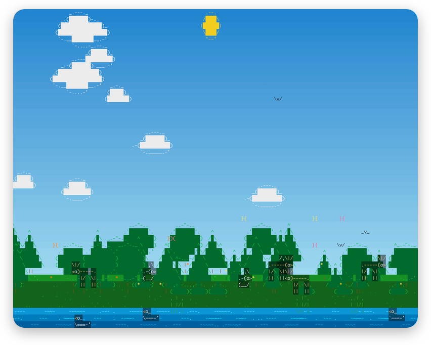
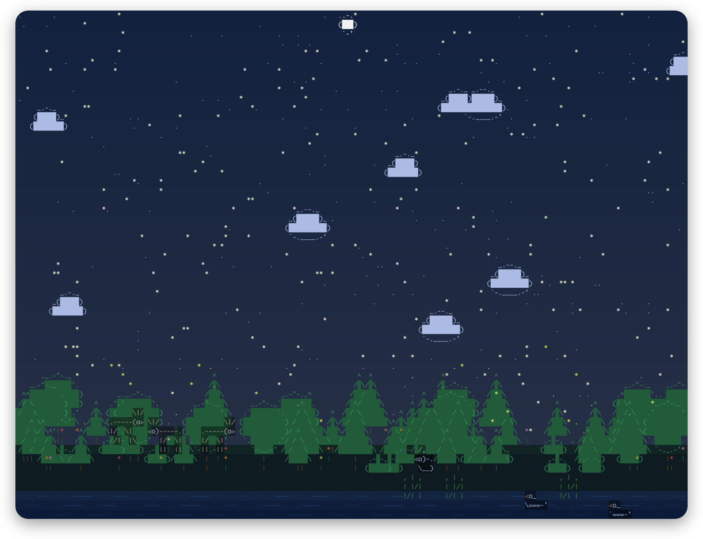
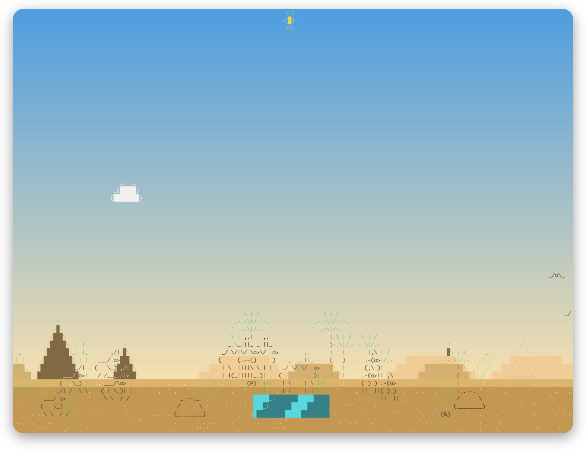
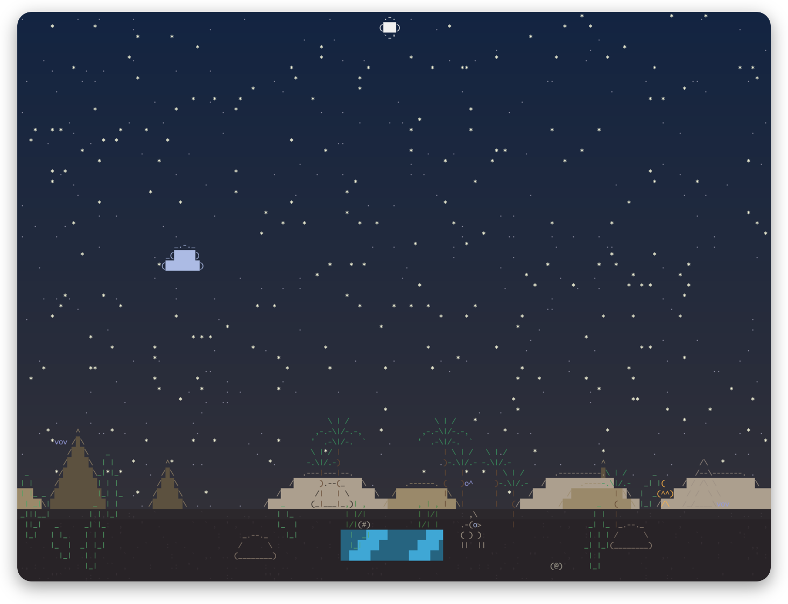
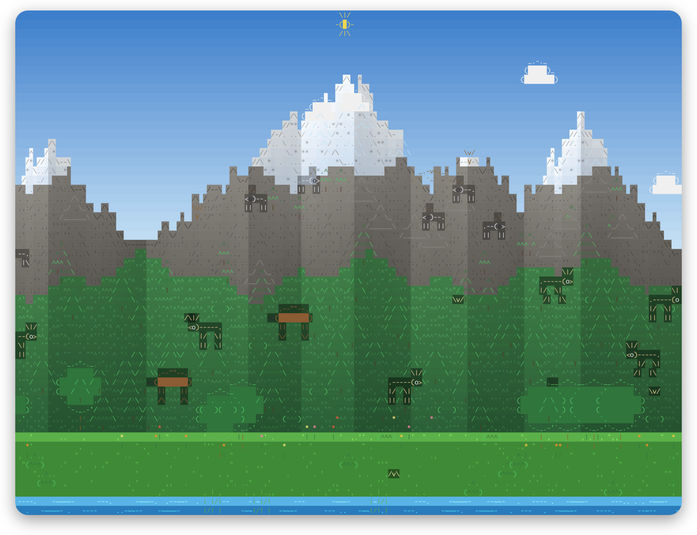
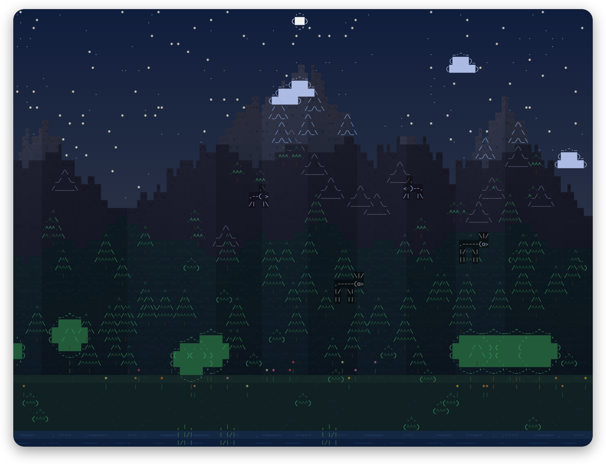
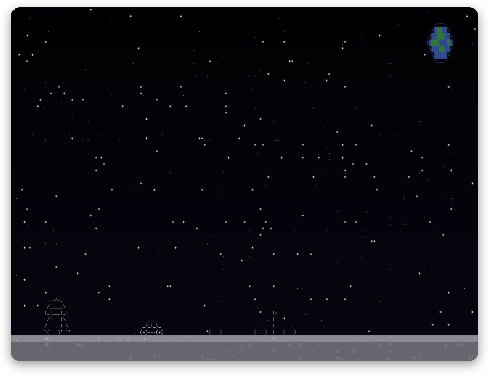

# Diorascii

Animated ASCII scenes for your terminal: an underwater aquarium, a forest with a
river, a desert with an oasis, a mountain range from the meadow up to the snow, a city with skyscrapers, traffic and trains, the surface of the moon, and more to come. Written in C++20 as one small, self-contained binary with
no runtime dependencies. Truecolor with automatic 256-color fallback, or a
terminal-themed look that follows your own colors.

**[Download the latest release](https://github.com/ChristianAhrens/Diorascii/releases/latest)**
&middot; [Project page](https://christianahrens.github.io/Diorascii/)
&middot; [API documentation](https://christianahrens.github.io/Diorascii/doxygen/index.html)

## Screenshots

Every scene by day and by night (on the moon: by lunar day and by earthrise).

<table>
  <tr><th></th><th>Day</th><th>Night</th></tr>
  <tr>
    <th>Aquarium</th>
    <td align="center"></td>
    <td align="center"></td>
  </tr>
  <tr>
    <th>Forest</th>
    <td align="center"></td>
    <td align="center"></td>
  </tr>
  <tr>
    <th>Desert</th>
    <td align="center"></td>
    <td align="center"></td>
  </tr>
  <tr>
    <th>Mountains</th>
    <td align="center"></td>
    <td align="center"></td>
  </tr>
  <tr>
    <th>Moon</th>
    <td colspan="2" align="center"></td>
  </tr>
</table>

## Download

Every release on the [releases page](https://github.com/ChristianAhrens/Diorascii/releases/latest)
contains one archive per platform. Unpack it and run `bin/diorascii` (`bin\diorascii.exe`
on Windows) from a terminal. Nothing else needs to be installed.

| Platform | Archive | Notes |
|---|---|---|
| macOS | `Diorascii-x.y.z-macOS.dmg` | universal (Apple silicon and Intel), disk image |
| Linux | `Diorascii-x.y.z-Linux.tar.gz` | 64-bit, no extra libraries |
| Windows | `Diorascii-x.y.z-Windows.zip` | Windows Terminal or Windows 10+ console |

The macOS binary is signed ad hoc but not notarized. If macOS refuses to open a
downloaded copy, clear the quarantine flag once: `xattr -d com.apple.quarantine bin/diorascii`.

## Usage

    diorascii                       # m menu, left/right scene, f action, x rare event, c style, t time of day, i info, p pause, r restart, q quit
    diorascii --scene moon          # start in a specific scene (--list-scenes shows all)
    diorascii --mute                # start without the ambient sound; a toggles it (see Sound below)
    diorascii --console             # force the Linux text console look (picked automatically on TERM=linux, also inside tmux)
    diorascii --style terminal      # 16 ANSI colors on your own background (also: mono, full)
    diorascii --dump 100            # headless: print the scene after 100 steps
    diorascii --dump 200 --act 20   # ...and trigger the scene's action at step 20
    diorascii --dump 400 --rare 20  # ...or summon the scene's rare event at step 20
    diorascii --hour 22             # start at 22:00 (scenes with a day and night cycle)
    diorascii --realtime            # let the time of day follow this computer's clock
    diorascii --gallery             # print every sprite (art review)
    diorascii --assets ./my-art     # add or override sprites and scenes from a directory

The menu (`m`, Enter or Esc) lists scene, style, time of day, info line, the scene's action, the rare event, resume
and quit, and shows the version and the copyright at the bottom. It is drawn into the same cell grid as the scene and driven only by abstract
actions (up, down, left, right, select, back), so any input device can use it.

### Scenes and the action key

`f` (or `F`) triggers the scene's primary action. What it does depends on the scene:

| Scene | Action | What happens |
|---|---|---|
| Aquarium | Feed the fish | a clump of eight twinkling flakes of food sinks from the surface (at most 30 at once); fish swim over and eat them, and the action's name flashes on screen so you can tell it worked |
| Forest | Make it rain | it rains for about 18 seconds (pressing again keeps it going): drops streak down at a slant and splash on the bank and in the river, clouds roll in and the light dims, then it clears up again |
| Desert | Sandstorm or tornado | a coin toss each time. A sandstorm blows grains across the whole screen for about 16 seconds while the sky turns ochre and the sun disappears. A tornado crosses the scene instead, weaving, whirling up sand and **throwing every animal in its path into the air**; they land dazed, and then walk on. Pressing again during a tornado brings the sandstorm on top of it. |
| Mountains | Snowstorm | an icy wind sweeps snow across the whole screen for about 22 seconds: flakes race sideways while they settle, the peaks and the sun vanish in a pale whiteout, the birds fall silent and the wind howls (see below) |
| City | Call an ambulance | an ambulance drives through the streets with its lights flashing |
| Moon | Meteor strike | a meteorite streaks down and hits the ground: it wrecks everything standing there, digs a crater and throws up debris and dust that drift back down slowly under the moon's low gravity. Dust then fills the crater gradually, shallow rim first, until the ground is smooth again. Rovers drive down into the crater and climb out as it fills. |

New scenes define their own action in their `*.scene` file (see below).

### The city

Buildings in three rows (a pale far row, a middle row and a front row) stand behind a narrow main street: a
sidewalk, a road of two lanes and a sidewalk. They run from low offices to towers of up to 80% of the sky, with
four kinds of facade (grid of windows, glass curtain wall, ribbons, small windows) and roofs with antennas, crowns,
water towers, helipads or steps, and their windows light up as it gets dark. Street lamps switch on at dusk and
pool light on the street. Cars, taxis, buses, trucks and cyclists keep to their side of the road, and the traffic follows the **rush hours**: it is thin at night and at midday and peaks at about 8:00 and 17:30 (a vehicle sprite with `rush: yes` only joins the street with the chance that the time of day gives), people walk on
both sidewalks (fewer at night), and there are shops, a kiosk and a park with a fountain, benches and trees. An
elevated railway runs through the buildings on a viaduct (a dark deck with bright rails on a concrete beam with
pillars, masts and a wire above it) with a station, and trains run on it now and then (on screens too small for it
there is no railway). On wide enough screens one to three **side streets** break off from the main street at a broad crossing with a zebra stripe, run a short way back between the buildings and disappear behind them: some cars turn off the main road into them, showing three-quarter and rear views as they turn and drive away, and others come down them, seen from the front, and turn onto the main road. Between the buildings of the front row (which are spaced out) you can sometimes see other side streets running back behind them. Planes come in on their landing approach in the background, sinking slowly behind the
skyline towards an airport that is off screen. Vehicles, trains and planes are drawn as fine line art on a darkened backing so that they stand out. The buildings are generated to the height of your terminal, always lower than the mountains' peaks.

### The mountains

Unlike the other scenes, which are mostly ground or mostly sky or mostly sea, the mountains use
the **whole height of the terminal**. From the bottom up: a green meadow with a small stream, a belt of
forest and bushes, bare rock with crags and dwarf pines, and snow and ice on the peaks, with the sky above
them. The peaks (a different range every run) are tall and the zones are bands of altitude whose edges
wobble from column to column, so the tree line and the snow line are never straight. The far flank of
every peak lies in shadow, the rock is streaked with gullies, and the sun and the moon set behind the ridges.

Everything lives in its own zone and stays there:

| Who | Where | What they do |
|---|---|---|
| Eagles | the sky, down as far as the rock | soar across the screen high up and now and then swoop down, wings folded, towards the rocky parts |
| Goats | the rock and the snow | leap along the ledges in hops, climb to other ledges and turn round where the rock ends instead of walking into the sky |
| Deer | the meadow and the forest | stroll about; they are the prey |
| Bears | the meadow and the forest | stroll about, then run a deer down and feast on it (one kill each, as with the lion) |
| Small birds | over the forest and the meadow | flit about by day |
| Trees, crags, spires | forest, rock, snow | firs and bushes in the forest, dwarf pines and crags in the rock, ice spires in the snow |

Things lower on the screen are nearer and drawn in front. Like everywhere, most animals sleep at night.

**Avalanche** (the rare event, `x` summons it): high on a snowy flank the snow starts to creak and trickle, then the slab
lets go and a powder cloud rips down the mountainside, **cutting a swath through the rock and the forest
down into the valley and across the stream**. Trees, bushes and animals in its path are buried; birds and
eagles are above it. The white swath, scattered with rubble, lies over the land and fades after about 40
seconds, the water coming back last; what was buried grows or walks back in over the next minute.

### Day and night

The aquarium, the forest, the desert and the mountains have a day and night cycle (a full day takes four minutes).
The sun crosses the sky by day and the moon by night, the sky and the water darken and
turn blue at night with a red glow at sunrise and sunset, and stars come out. Creatures
can belong to the day or the night: butterflies and birds by day, fireflies by night.
Clouds from the forest's rain dim the day, too. The moon has a cycle of its own: it has no atmosphere, so the sky stays black with its stars all the time. By day a large sun stands high in the sky over a slightly lighter grey ground; by night the earth rises over a darker, cooler one.

At night **most animals sleep**: a share of every species (about 70% for most) disappears
and stays frozen where it is, each at its own bedtime, so herds and schools thin out
one after another over dusk and wake up one after another at dawn. Sleepers do not eat,
hunt or get hunted. A few animals stay up, and some are nocturnal, like the desert's
bats and the lion.

`t` (or the menu) steps through *cycle, dawn, day, dusk, night, real time*: the first runs the
clock, the next four freeze the time of day, and *real time* follows the clock of the computer
Diorascii runs on (also `--realtime`), so the scene's day, dusk and night match the one outside.
`--hour` sets the start time. The time of day
carries over when you switch scenes. The info line (`i`) shows the clock.

In the terminal styles the cycle shows in the stars, the sun and moon and the creatures
coming and going; the colors themselves stay with your terminal theme.

### Sound

Ambient sound is synthesized at run time (no recordings) and on by default: `--mute` starts without it, and the `a`
key or the menu's Sound entry switch it. Without a sound device the app simply stays silent.
Every scene has its own soundscape, and the sound follows what happens on screen:

| Scene | What you hear |
|---|---|
| Forest | soft wind in the trees that swells with slow gusts, deeper in a storm; crickets at night; rain. A thundercloud on its way brings distant rumbling and far-off claps; a lightning strike cracks at the moment of the screen flash, then the thunder rolls in |
| Aquarium | a deep underwater hum, bubbles rising now and then, a small blip for every flake of food a fish eats, the song of a passing whale the growl of the kraken as it nears, and a muffled double gulp for every animal its tentacles swallow |
| Desert | a dry, steady wind, a few crickets at night; in a sandstorm the wind howls with the hiss of blown sand, and a tornado crossing the scene adds a deep, turning roar. The sandworm shakes the ground as it nears, bellows with a very deep, trumpeting roar while it crosses, and each animal it swallows is chewed with a series of low, grumbling crunches |
| Mountains | thin alpine wind, a gurgling stream and now and then, by day, the shrill cry of an eagle or a woodpecker drumming on a tree. A snowstorm brings a howling icy wind with a gliding whistle and the hiss of ice crystals, and silences the eagle and the woodpecker; an avalanche creaks, then breaks with a burst of crackling and swells into a deep rumble with the roar of tumbling snow and rock, crackling and thumping as it knocks down trees and boulders on its way, and every animal it buries lets out a short, muffled squeal |
| City | a steady murmur of traffic that thins out at night, cars passing by with a sinking engine note, a horn (sometimes two honks, sometimes one long blast) from time to time, the quick two-tone siren of the ambulance and the slow, wailing siren of the fire engine (which drives off without it once the fire is out), trains that rumble and beat out the regular "klack-klack, klack-klack" of the wheels over the rail joints and sound their horn as they arrive, a faint jet when a plane is on its approach, and the roar and crackle of a burning skyscraper |
| Moon | no air, so only what could be felt through the ground: a faint, deep drone. A meteor strike thuds up through the ground, with a dull rumble and debris pattering down slowly; the alien's flash comes with an eerie warble |

### Rare events

Every scene has a rare catastrophe that turns up every few minutes (the first one after
two to five minutes) and wipes out life. It is announced by its arrival: it crosses the
scene, strikes halfway across, and moves on. Press `x`, or choose *Rare event* in the menu,
to summon it right away instead of waiting.

| Scene | Catastrophe | What happens |
|---|---|---|
| Aquarium | Kraken | a giant sea monster lumbers across the sea bed, the water darkens to violet, and it **lashes out with tentacles at the animals around it** as it goes: whatever a tentacle reaches (fish, jellyfish, eels, crabs, shark, whale) bursts into ink, and animals out of reach survive |
| Forest | Thunderstorm | a dark cloud rolls across the sky and it starts to pour; a lightning bolt hits the ground under the cloud, the screen flashes twice, and **every animal dies** |
| Desert | Sandworm | a huge banded worm with a toothed maw crawls through the dunes in a cloud of dust and **lashes out a tongue at the animals on the ground ahead of it and swallows each one it reaches** (what flies is spared) |
| Mountains | Avalanche | the snow on a high flank cracks, then a powder cloud rips down the mountain, through the forest and into the stream, **burying trees, bushes and animals** in its swath |
| City | Fire | a skyscraper catches fire: flames lick up its facade and over the roof, smoke billows, a fire engine races through the street with its siren, **parks in front of the building and sprays it with jets of blue water**, which puts the fire out sooner, and drives off without its siren as soon as the last fire is out. Most of the time the fire is beaten and the building is wrapped in scaffolding with a crane and **renovated** with new looks. **Sometimes the fire wins**: it spreads to 3 to 5 neighbouring buildings one after another, they all **burn down** (they collapse into smouldering rubble), the engine leaves when the flames are out, and it takes a long while, about a minute and a half, before everything is **rebuilt** from the rubble. From the arrival of the engine until the last building is back, the site (wider if the fire has spread) is **cordoned off** with barriers across the road and both sidewalks: all other vehicles and people stop in front of them and wait |
| Moon | Alien | an alien walks across the surface and **destroys the flagpole and the rover each at the moment it passes them** (a rover that drives out of its way is spared), and nothing else |

The avalanche is the exception to "crosses the scene": it comes down a mountainside (see above) and
buries what is in its path instead of everything alive.

The dead do not stay dead: they come back one by one over the next minute or so, animals
walking in from the edges and the flagpole planted again. Sleeping animals die unseen.

### Styles

| Style | Look |
|---|---|
| `full` (default) | gradient backdrops and the scene's own colors |
| `terminal` | no backdrop: your terminal's background, sprites in the 16 named ANSI colors so they follow your theme |
| `mono` | no color at all: only your terminal's own foreground and background |

Switch with `--style`, the `c` key or the menu.

## Build

    scripts/build.sh            # macOS / Linux  -> build/<preset>/src/diorascii
    scripts/build.ps1           # Windows        -> build\release\src\Release\diorascii.exe

Needs only CMake 3.21 or newer and a C++20 compiler. `scripts/build.sh dev` makes a
debug build and runs the tests. Assets are embedded into the binary at build time.
`-DDIORASCII_VERSION=x.y.z` sets the version the binary reports.
tvOS (macOS with Xcode only): the Apple TV app is generated and built by CMake, there is no
hand-made Xcode project.

    cmake -S . -B build/tvos -G Xcode -DCMAKE_SYSTEM_NAME=tvOS -DCMAKE_OSX_SYSROOT=appletvsimulator
    cmake --build build/tvos --target Diorascii -- CODE_SIGNING_ALLOWED=NO
    xcrun simctl install booted build/tvos/apple/tvOS/Debug-appletvsimulator/Diorascii.app

The generated project serves both the simulator and devices (pick the destination in Xcode);
configure with `-DCMAKE_OSX_SYSROOT=appletvos -DDIORASCII_APPLE_TEAM=<team id>` to sign for a device. Siri Remote: swipe left/right
changes the scene, swipe up the time of day, swipe down the sound, click runs the scene's action,
Play/Pause pauses, holding the click opens the menu (swipes and click then navigate it), Menu closes
the menu or leaves the app.

With GCC the C++ runtime is linked statically for a single-file binary when the static library
is installed (Fedora: `dnf install libstdc++-static`); without it the build falls back to the shared one.

## Extending: sprites

A `*.sprite` file is a header of `key: value` lines followed by one or more
`--- art` frames, each optionally followed by a `--- mask`. Drop it into a
directory and pass `--assets DIR` (or put it in `assets/` to ship it).

    name: darter
    facing: right            # direction the art points
    habitat: medium          # medium (water) | surface | sky | ground | river | rail (the city's elevated railway)
    speed: 9..18             # cells per second
    depth: 3..16             # draw order, larger = further away
    tag: prey                # lets behaviors find it (prey, food, ...)
    behaviors: seek_food swim emit_bubbles
    pool: warm               # color pool for mask digits 1-9: warm | cool | earth
    --- art
    <=={o>
    --- mask
    2111W1

Header keys:

| Key | Meaning |
|---|---|
| `name`, `facing`, `habitat`, `speed`, `depth`, `tag`, `behaviors`, `pool` | as in the example |
| `fps`, `loop: no` | animation speed; stop on the last frame |
| `die-after-animation: yes` | remove the sprite when its animation has played once |
| `color: #rrggbb` | default color (used for blank mask cells) |
| `random-frame: yes` | start on a random frame (for particles) |
| `ttl: 2..4` | lifetime in seconds |
| `slope` | diagonal flight: vertical speed relative to horizontal |
| `anchor-row` | which sprite row sits on the surface line |
| `mouth-row` | row where it eats or bites |
| `bubble-rate`, `bob-amplitude`, `bob-frequency` | tuning for those behaviors |
| `behaviors: drive`, `turns: 0.3` | a city vehicle that drives along the main road and, with this chance, turns off into the next side street |
| `feet-rows: 1..-2`, `traffic: yes` | a ground sprite's feet stand on these ground rows (0 is the first, a negative number counts from the bottom); with `traffic` vehicles keep to their side of the road: the lower rows of the range moving right, the upper rows moving left |
| `lanes: 4` | ground sprites stand up to this many rows deep on the bank; the ones further forward are drawn in front |
| `altitude: 8` | sky sprites hover within this many rows above the ground |
| `active: day` or `night` | only shown by day or by night (needs a day and night cycle in the scene) |
| `glow: yes` | not dimmed at night (fireflies, sun, moon) |
| `sleeps: 0.7` | this share of the animals sleeps at night (frozen and hidden, each from its own sun height); needs a day and night cycle |
| `herd: 4..7`, `herd-spacing` | spawned in herds of this size that move together; members that leave come back from the same side facing the same way. In a scene's population one unit means one herd |
| `contrast: yes` | dark strokes where the background behind a cell is light (pale sand), the sprite's own color where it is dark (full style only) |
| `feast-time`, `hunt-effect` | for hunters: how long they stay put after a kill, and the sprite shown at the kill |
| `dust-rate` | puffs of dust kicked up per second by `emit_dust` |
| `wind: yes` | a particle that is blown across the whole scene (sand), for a weather action |
| `life: yes` | a living thing: catastrophes that wipe out life take it |
| `row: 2` | pinned to this row (a negative number counts from the bottom) |
| `wipes`, `strike-mode`, `strike-at`, `strike-reach`, `strike-aim`, `strike-lashes`, `lash-color`, `strike-effect` | for catastrophes (behavior `catastrophe`): `life` or a list of sprite names to wipe out; how it strikes (`centre`, the default: everything at once when it is `strike-at` (0 to 1) of the way across the scene, like a storm; `sweep`: each victim as the middle of the attacker passes it; `devour`: each victim in its way as its front reaches it, and with `strike-reach: N` it lashes a tongue or tentacle out at victims up to N cells away, drawn from the row `mouth-row` in `lash-color`; `strike-aim: ahead` (default) reaches walking things ahead of its front, `around` anything alive around it, from along its underside, and `strike-lashes: N` lets N be out at once); and the sprite shown on every victim |
| `strike-sprite`, `screen-flash`, `storm-rain` | a bolt that hits the ground under the attacker, seconds of screen flashing (two quick flashes), and seconds of rain it brings (needs a weather action in the scene) |
| `tag: gloom` | the scene darkens (like heavy weather) while this sprite is around |
| `backing: 0.5` | darkens the background behind the sprite's glyphs by this share (full style only), so light sprites stay readable on bright and dark backdrops |
| `hop-period`, `hop-height` | seconds per hop and hop height in rows, for the `hop` behavior |
| `destructible: no` | survives meteor strikes (ground sprites are destructible by default) |
| `solid: yes` | the sprite may paint solid color blocks (see mask rules) |
| `zone: forest` | on a mountain, where it lives: `meadow`, `forest`, `woods` (both), `rock`, `snow`, `alpine` (both) for things on the ground, `sky`, `air` (down to the rock) and `low-air` (over the forest and the meadow) for flyers. Ground sprites stand in a random place of the zone and never in the sky; give them `habitat: ground` |
| `fall: 0.5..4` | for a `wind: yes` particle: how fast it also falls, in rows per second (snow) |
| `density: 1.6` | for a `wind: yes` particle: how many fall per second, relative to sand |

Mask rules: `1`-`9` use the creature's randomized palette, letters are fixed
colors (`W`hite `R`ed `G`reen `B`lue `C`yan `Y`ellow `M`agenta `O`range blac`K` `T`an `N`brown `P`ink `L`ight gray `S`and;
lower case = darker), a space is the default color. A space in the art with
mask `_` is opaque, with a color letter it is a solid block of that color. A color
letter on a blank art cell is only allowed in sprites that declare `solid: yes`;
the test suite rejects it everywhere else because it is almost always a misaligned
mask.

Behaviors:

| Behavior | Effect |
|---|---|
| `swim` | horizontal travel; leaves the world at the edge |
| `fly` | travel in both axes |
| `walk` | like `swim`, but follows the ground, dipping into craters |
| `bob` | gentle vertical bobbing |
| `rise` | rises and pops at the surface (bubbles) |
| `sink` | falls, then lies on the ground for a while (food) |
| `emit_bubbles` | now and then releases a bubble |
| `seek_food` | turns towards the closest food, swims to it and eats it |
| `hunt` | eats every sprite tagged `prey` that its mouth touches; counts kills and can feast afterwards |
| `chase` | runs down the closest `prey`: turns towards it, changes lane to line up and closes in; gives up after its first kill |
| `emit_dust` | kicks up puffs of dust behind its feet |
| `catastrophe` | crosses the scene and strikes once, wiping out `life` or named sprites; the victims come back later, one by one |
| `twister` | a tornado: weaves across the scene, whirls up sand and throws animals in its path into the air |
| `ballistic` | thrown under the scene's gravity, gone when it lands (debris, dust) |
| `meteorite` | streaks down and strikes the ground where its head arrives |
| `wander` | drifts like `swim` with an organic wobble (butterflies, fireflies, birds) |
| `hop` | moves in hops: rests, then jumps forward in an arc |
| `rain` | a raindrop: falls to its landing row, makes a splash and is gone |
| `ledge` | on a mountain: walks (or hops, with a `hop-period`) along a ledge of its `zone`, turns round where the zone or the mountain ends and now and then climbs to another ledge |
| `soar` | on a mountain: flies across the scene and swoops up and down within its `zone` band, now and then diving (frames: wings up, wings down, gliding, diving) |
| `avalanche` | the powder cloud of an avalanche: creaks on a snowy flank, then rips down it, scarring the land and burying what stands in its way |
| `drive` | a city vehicle: drives along the main road in its lane, can turn off into side streets (`turns`) and shows its five views as it turns; stops in front of a cordon |
| `engine` | the fire engine: drives to the burning building with its siren, parks, sprays water, leaves without the siren once no building burns, and cordons the site with barriers while it stays |
| `blaze` | the city's rare event (an invisible sprite): sets a skyscraper on fire; the fire is either beaten or spreads and burns 3 to 5 more buildings down, which are rebuilt later |

## Extending: scenes

A `*.scene` file describes a whole world as data; sprites are shared between
scenes. See `assets/scenes/aquarium.scene`, `moon.scene` and `mountains.scene`.

    name: aquarium
    title: Aquarium
    sky: #06081c #223462            # top and bottom colors
    medium-colors: #1e7896 #051642  # surface and deep (omit with "medium: no")
    ground-colors: #967c52 #765e3c
    sky-fraction: 0.2               # share of the height above the surface (1 = all sky)
    ground-rows: 2
    stars: 23                       # one star per N sky cells
    action: drop food               # what the f key does: drop | impact <sprite>, weather <sprite> [<funnel>], summon <sprite>, or none
    action-label: Feed the fish     # text of the menu button
    gravity: 2.5                    # cells/s^2 for falling debris
    dust-settle: 40                 # seconds for dust to fill one row of a crater
    river-rows: 3                   # rows at the bottom of the ground that are a river
    river-colors: #4aa0d8 #1f6aa5   # river colors from the bank down
    river-flow: 2.5                 # cells per second the ripples drift
    mountains: yes                  # the whole height is a mountain range (see "The mountains")
    peak-height: 0.86               # altitude of the highest peak, as a share of the height
    treeline: 0.46                  # altitudes of the tree line and the snow line, as shares of the height
    snowline: 0.68
    forest-colors: #3f7d48 #2b5e36  # colors of the forest, rock and snow, from the higher part down
    rock-colors: #8c8882 #6a6660
    snow-colors: #f4f8fc #cfdeee    # (ground-colors and ground-glyphs are the meadow; there are also
                                    #  forest-glyphs, rock-glyphs and snow-glyphs)
    weather-duration: 18            # seconds a rain shower lasts
    overcast-tint: #c98e4c 0.75     # color (and strength) the scene turns towards in heavy weather
    day-night: yes                  # sun, moon, stars and dimming light
    city: yes                       # a skyline of skyscrapers behind a street (the ground rows are sidewalk, road, sidewalk)
    avenues: 3                      # side streets running off into the city (at most; fewer on narrow screens)
    skyline: 0.18..0.80             # height of the buildings as shares of the sky above the street (low offices to towers)
    airless: yes                    # no atmosphere (moon): black sky and stars all day, only the ground shifts a little
    day-length: 240                 # seconds for one full day
    start-hour: 10                  # time of day at the start
    sun-sprite: sun_big             # sprites that cross the sky by day and by night
    moon-sprite: moon_big
    event-interval: 12..35          # seconds between rare visitors
    rare-first: 150..300            # seconds until the first rare catastrophe, and between later ones:
    rare-interval: 300..600

    --- population                  # <sprite> per-cells|per-cols|count <n>
    darter  per-cells  230
    @seaweed per-cols  15           # built-in procedural plant

    --- decor                       # <sprite> left|right|center|random <margin> [y <row>]
    castle  right  2

    --- events                      # <sprite> <weight>; one at a time
    shark   3

    --- rare                        # <sprite> <weight>; one catastrophe at a time, on a slow timer
    kraken  1

The scene's colors are its daytime look; the night look is derived from them. The
river takes at most half of the ground rows at the bottom, and a ground of more than a
quarter of the height is shortened, so the scene adapts to small terminals.

Scene files are checked on load: a reference to a sprite that does not exist is
reported as an error instead of being silently ignored.

## Documentation

The [project page](https://christianahrens.github.io/Diorascii/) links the latest
release, this repository and the generated
[API documentation](https://christianahrens.github.io/Diorascii/doxygen/index.html). To
build the documentation yourself, install [Doxygen](https://www.doxygen.nl) and
Graphviz and run `doxygen Doxyfile` (or `cmake --build <dir> --target docs`); the
result is in `docs/html`.

## Releasing

Work happens on `develop`; `main` only receives merges for releases. [CHANGELOG.md](CHANGELOG.md)
([Keep a Changelog](http://keepachangelog.com/en/1.0.0/) format) is the single source of the
version and of the release text: new entries go under `## [Unreleased]` as they are made, and CMake
takes the version from the latest released section (`## [1.2.3] 2026-11-07`). A build that is not
exactly that release's tagged commit reports `1.2.3-dev+<commit>`. To release:

1. On `develop`, rename `## [Unreleased]` to `## [1.2.3] <date>`, add a fresh empty
   `## [Unreleased]` above it, and commit. `scripts/release-notes.sh Unreleased` previews the
   text before, `scripts/release-notes.sh 1.2.3` after.
2. Merge `develop` into `main` and tag it:

       git tag 1.2.3
       git push origin main 1.2.3

Pushing a tag in the form `x.y.z` (major.minor.fix, no `v` prefix) builds Diorascii on
macOS, Linux and Windows, runs the tests and publishes a GitHub release with one
archive per platform. The tag must match the latest released section of the changelog, or
the workflow stops before building anything; that section, without its empty subsections, is
the text of the release.

The release is created as a draft and only published once all three platforms built
and passed their tests. The binaries report the tag as their version. Every push to
`main` also redeploys the project page and the API documentation to GitHub Pages.

The tvOS app goes to App Store Connect (TestFlight) with one script, which generates the project
with CMake, archives it, signs it with automatic signing, exports the `.ipa`, validates it and
uploads it:

    scripts/package-tvos.sh you@example.com [TEAMID]    # DIORASCII_SKIP_UPLOAD=1 to stop after validating

If the App Store distribution profile (`DIORASCII_PROFILE`, default "Diorascii tvOS distribution profile",
downloaded from the developer portal and installed by double-clicking it once) is installed, the app is
signed manually with it and its Apple Distribution certificate, which needs no registered Apple TV;
without it automatic signing is used, which does.

It uses the same keychain item for the app-specific password as the other Apple projects
(`AppSpecificPW`, stored with `xcrun altool --store-password-in-keychain-item`), takes the team from the
argument, `DIORASCII_APPLE_TEAM` or your signing certificate, and numbers the build by the commit count
(`DIORASCII_BUILD_NUMBER`), which App Store Connect needs to grow with every upload. The app record
`com.ChristianAhrens.Diorascii` for tvOS must exist in App Store Connect first.

The macOS asset is a disk image with the binary, a `usr-local-bin` link to drop it onto
(`/usr/bin` itself is protected by macOS) and an installer script for `~/.local/bin`. The
copy CI builds is only ad-hoc signed. To build the same image with your own Developer ID
signature and Apple's notarization, run on a Mac:

    scripts/package-macos.sh 1.2.3          # -> dist/Diorascii-1.2.3-macOS.dmg

It picks the first "Developer ID Application" identity in your keychain (or
`DIORASCII_SIGN_IDENTITY`), signs the binary with the hardened runtime and the image with
the same identity, submits the image with `notarytool` using the keychain profile
`APP_NOTARIZATION_CREDENTIALS_PROFILE` (`DIORASCII_NOTARY_PROFILE` to use another, created
once with `xcrun notarytool store-credentials`) and staples the ticket. Without an identity, or with
`DIORASCII_ADHOC=1`, it falls back to the ad-hoc signature and skips notarization, which is
what the release workflow does. `DIORASCII_SKIP_NOTARIZE=1` signs only.

## Layout

    src/core   headless simulation, frame buffer, menu (no I/O, deterministic per seed)
    src/term   VT/ANSI encoder and the terminal backends (posix, windows)
    src/audio  ambient sound playback (the synthesis itself is in src/core/ambience)
    src/app    interactive session logic (shared by frontends), command line + terminal main loop
    assets/    sprites and scenes, embedded at build time (cmake/embed.cmake)
    pages/     landing page deployed to GitHub Pages
    scripts/   build and packaging helpers, release-notes.sh (changelog section -> release text)
    CHANGELOG.md  per-release changes; source of the version and of the release text
    tests/     dependency-free tests (ctest)
    docs/ai/   notes for AI collaborators: history, architecture, conventions, rules, open findings (see CLAUDE.md)

The core only produces a grid of styled cells and consumes abstract actions, so
other frontends (such as a tvOS app) can be added without touching it.

## Status

Six scenes (aquarium, forest, desert, mountains, city, moon) with original sprites; feeding, predation,
rain, sandstorms and tornadoes, snowstorms, meteor strikes with craters, avalanches, herds, hunting
lions and bears, a day and night cycle with sleeping animals, scheduled events, rare catastrophes
(kraken, thunderstorm, sandworm, avalanche, alien), synthesized ambient sound, three render styles
and an ASCII menu work.
A first tvOS app (see Build) shows the same scenes on the Apple TV; it is built from the same repository but not part of the release archives.

## License

[MIT](LICENSE) &middot; [Privacy](PRIVACY.md)

## Credits and legal

Diorascii is inspired by [asciiquarium](http://robobunny.com/projects/asciiquarium) by
Kirk Baucom, the classic Perl aquarium for the terminal, whose ASCII art is largely by
Joan Stark. Thanks to them, and to everyone who ported it, for a delightful idea.

Diorascii is an **independent, legally clean rewrite**, not a port or a fork in
substance:

- no source code from asciiquarium or any of its ports is included, and the C++
  code, file formats and engine were written from scratch;
- no ASCII art from asciiquarium or any of its ports is included; every sprite in
  this repository was drawn for Diorascii;
- only the general idea of an animated ASCII aquarium was taken as inspiration, and
  ideas are not covered by copyright.

asciiquarium is licensed under the GPL. Diorascii deliberately is not derived from it
and is released under the permissive [MIT license](LICENSE), so it can be used,
redistributed and shipped (including through app stores) without GPL obligations.
This is a statement of how the project is made, not legal advice.

Ambient sound is played through [miniaudio](https://miniaud.io) by David Reid, vendored as a
single header in `third_party/miniaudio` (playback only). It is available under the public
domain (Unlicense) or MIT No Attribution terms, which are compatible with this project's MIT
license and with app store distribution; its license text is kept next to it. The sounds
themselves are synthesized at run time, so no audio recordings are included.
