# Diorascii user manual

Diorascii fills your terminal with a living, animated ASCII-art scene: fish drifting through an aquarium, rain
falling on a forest, a sandworm crossing the desert, traffic and trains in a city, rovers on the moon. It is one
small program with nothing else to install, it runs on macOS, Windows and Linux (x64 and arm64), and it
is made to be left running in a corner of your screen, or to be played with: you can feed the fish, make it rain,
call an ambulance, and now and then something terrible happens to everybody.

## Install it

Every release has an installer for each platform, and nothing else needs to be installed:

| You use | Do this |
|---|---|
| **macOS** | download the `.pkg` of the [latest release](https://github.com/ChristianAhrens/Diorascii/releases/latest) and open it |
| **Windows** | download the `-Windows-Setup.exe` (or the portable `.zip`) and run it |
| **Debian, Ubuntu, Raspberry Pi OS** | `sudo apt install ./Diorascii-x.y.z-Linux-x64.deb` (or `-arm64.deb`) |
| **Fedora, openSUSE** | `sudo dnf install ./Diorascii-x.y.z-Linux-x64.rpm` (or `zypper install`) |
| **Any other Linux** | unpack the `.tar.gz` and run `bin/diorascii` |

Then open a *new* terminal and run `diorascii`; `q` quits. All the downloads, with direct links, upgrading,
uninstalling and the terminal to use are on the [Installation page](install.md). **Apple TV** (tvOS) is built from the
source, see [Installation](install.md#apple-tv-tvos-and-ios).

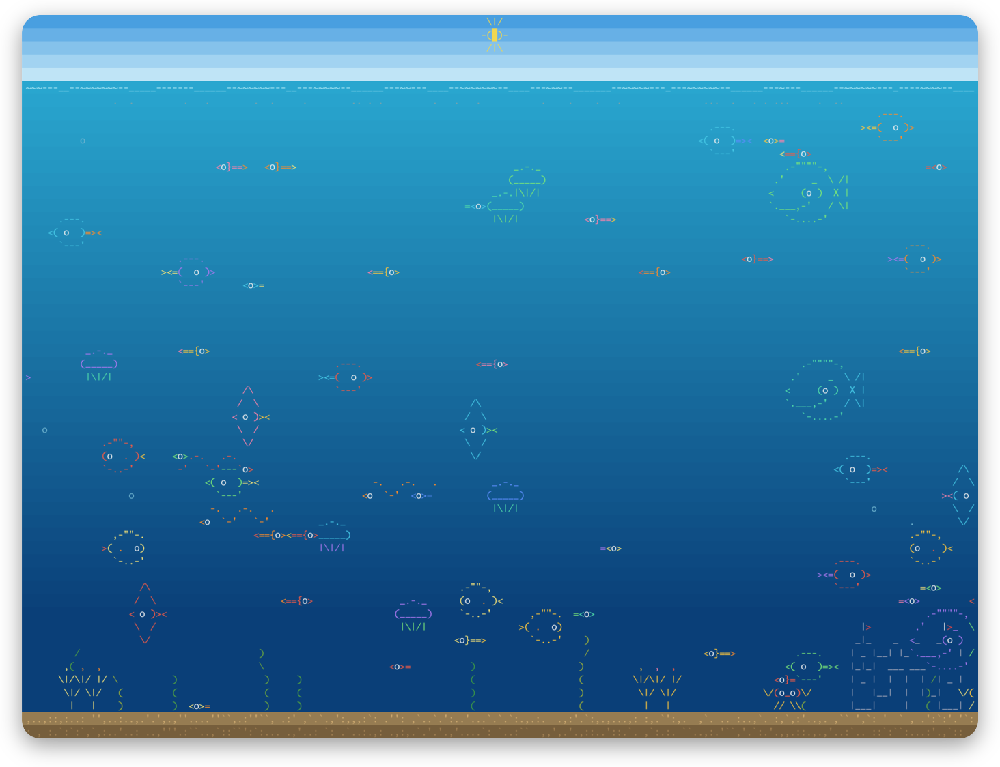

## What you get

- **Six scenes**: an aquarium, a forest with a river, a desert with an oasis, a mountain range from the meadow up to
  the snow, a city and the surface of the moon. Each is full of animals or vehicles that live their own lives.
- **A day and night cycle**: sun, moon and stars cross the sky, the colors turn, most animals go to sleep, and you
  can pin the time of day or let it follow your computer's clock.
- **A mode that runs itself**: by default Diorascii goes through all the scenes by itself, each for one full day and
  night with a rare event and regular events along the way, so it can be left running as a screensaver; the *user
  mode* (`--user`, or the `o` key) gives you the control instead.
- **Things to do**: every scene has an *action* (feed the fish, make it rain, call an ambulance, strike the moon with
  a meteor...) and two rare *catastrophes* (a kraken, a flood, a yeti, monsters fighting in the city...).
- **Sound, stereo or immersive**: ambient sound for every scene, synthesized while it runs, which follows what happens
  on screen. *Immersive* (the default) plays on all the speakers of a surround system, up to 9.1.6 with height
  speakers, and gives AirPods their 3D audio on macOS and Apple TV; *stereo* is a plain pair. See [Sound](usage.md#sound).
- **Your look**: truecolor with an automatic 256-color fallback, or a style that follows your own terminal colors,
  or no color at all.
- **No dependencies, no network, no settings files**: it does not read or write anything of yours.

## A first look

Every scene, by day and by night (on the moon: by lunar day and by earthrise):

<table>
  <tr><th></th><th>Day</th><th>Night</th></tr>
  <tr>
    <th>Aquarium</th>
    <td align="center"></td>
    <td align="center">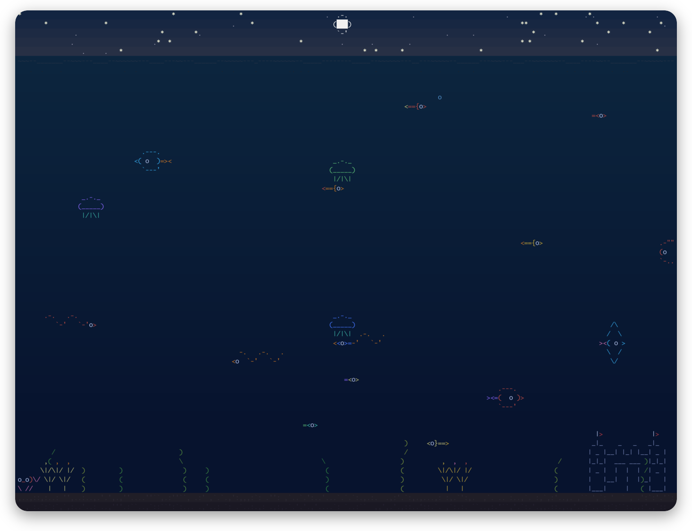</td>
  </tr>
  <tr>
    <th>Forest</th>
    <td align="center">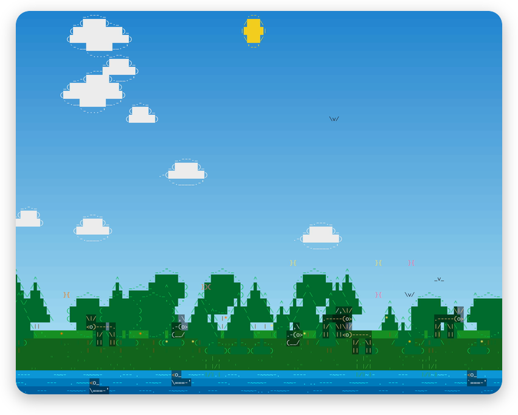</td>
    <td align="center">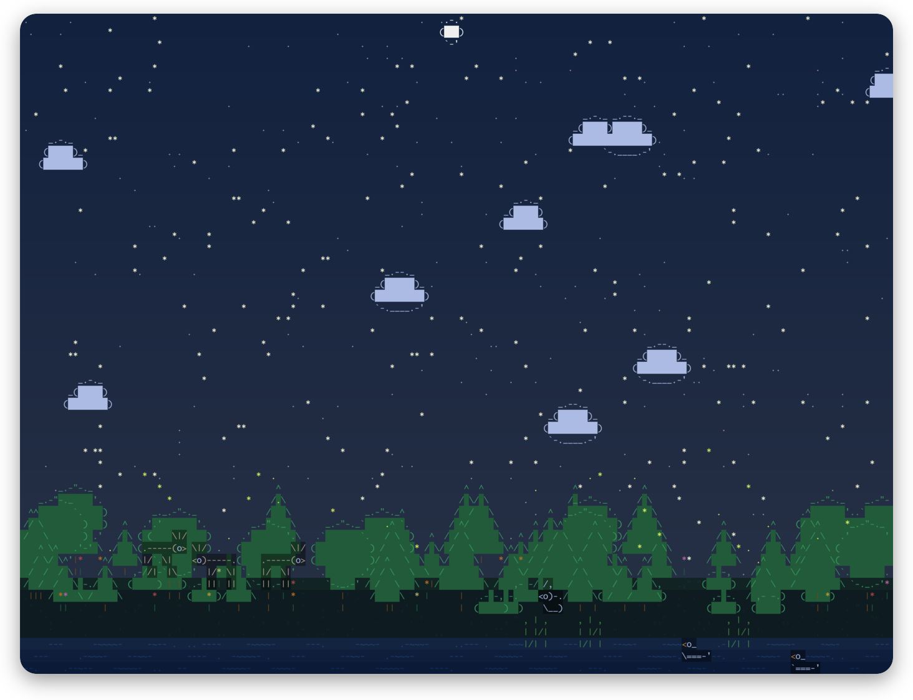</td>
  </tr>
  <tr>
    <th>Desert</th>
    <td align="center">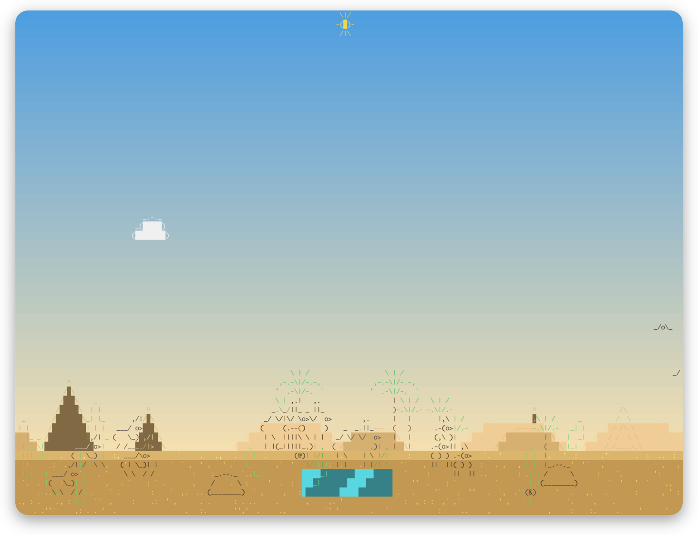</td>
    <td align="center">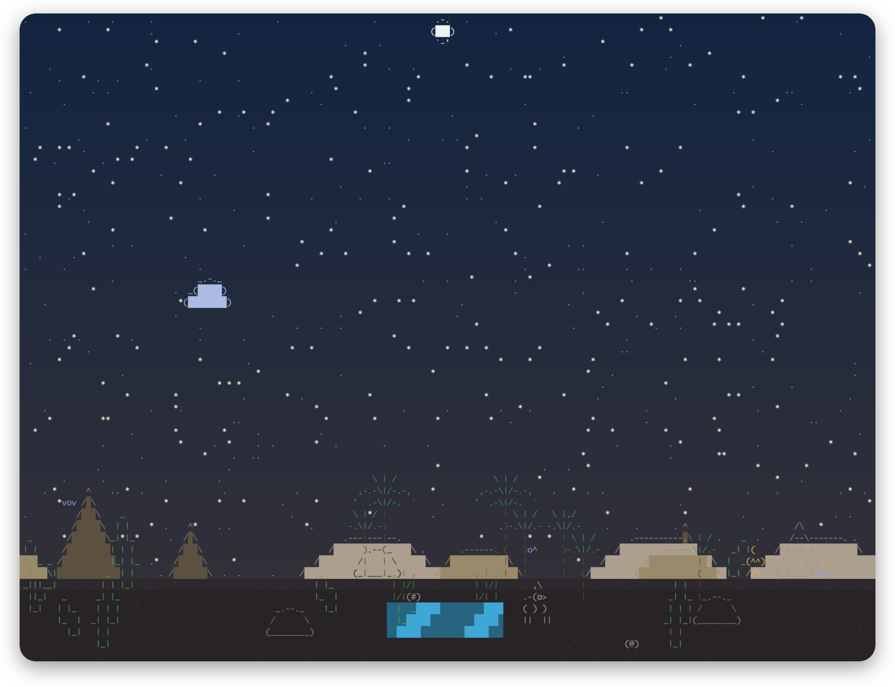</td>
  </tr>
  <tr>
    <th>Mountains</th>
    <td align="center">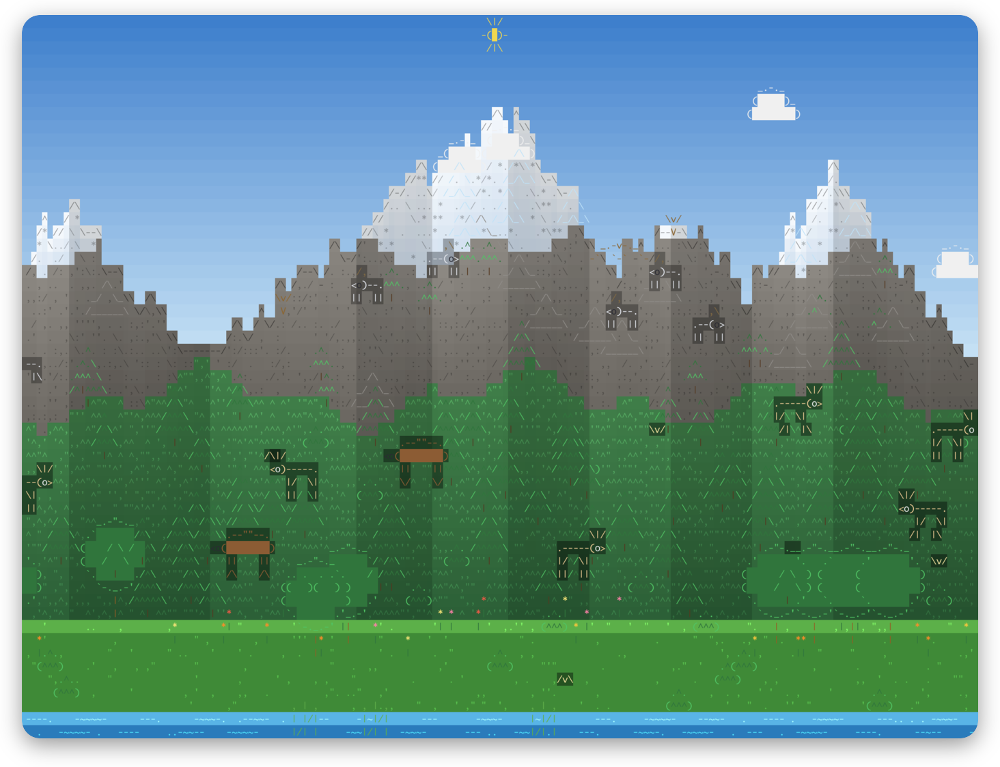</td>
    <td align="center">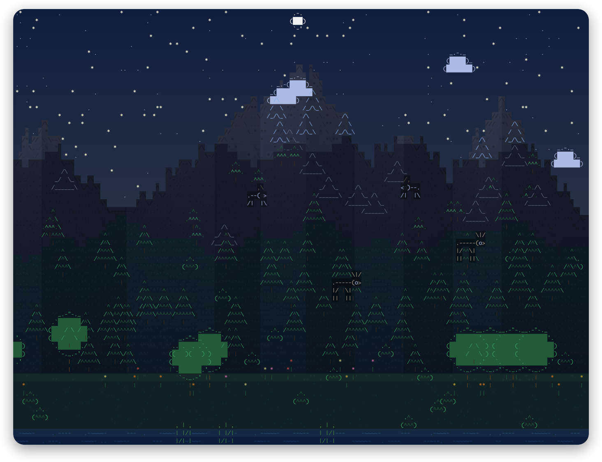</td>
  </tr>
  <tr>
    <th>City</th>
    <td align="center">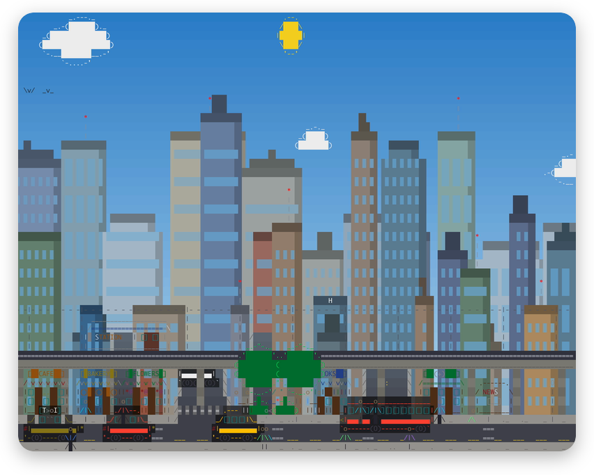</td>
    <td align="center">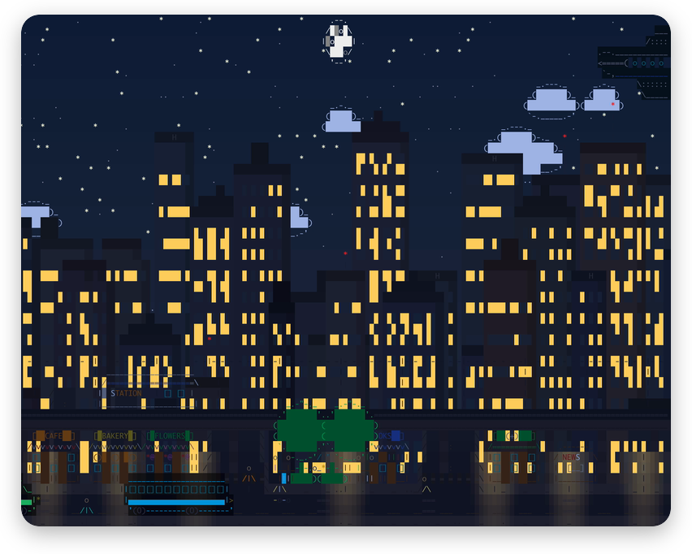</td>
  </tr>
  <tr>
    <th>Moon</th>
    <td align="center">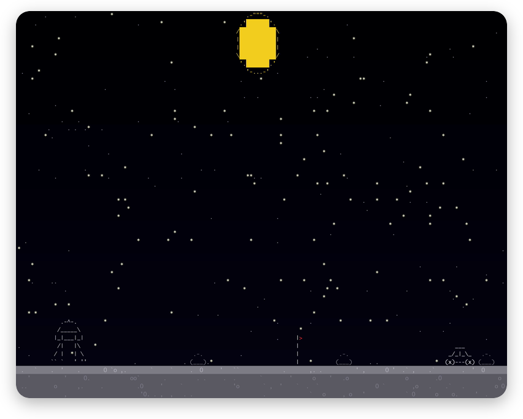</td>
    <td align="center">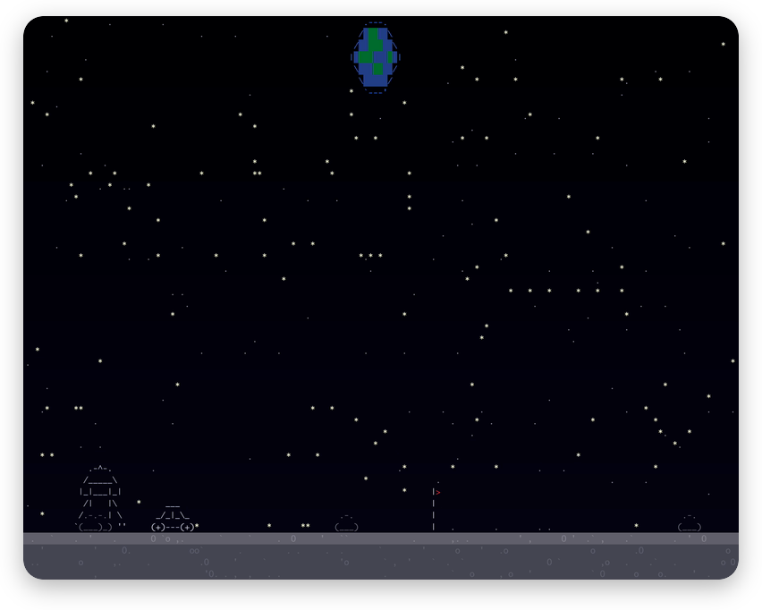</td>
  </tr>
</table>

## Where to go from here

1. [Installation](install.md): get Diorascii onto macOS, Windows or Linux (and Apple TV), with direct download links.
2. [Using Diorascii](usage.md): start it, the keys, the menu, styles, time of day, sound (stereo and immersive, per platform) and the command line.
3. [The scenes](scenes.md): what lives in each scene, what its action does, and what the catastrophes are.
4. [Troubleshooting](faq.md): wrong colors, no sound, garbled characters, and other questions.

Diorascii is free software under the MIT license. The source code is on
[GitHub](https://github.com/ChristianAhrens/Diorascii); bug reports and ideas are welcome there as issues.
