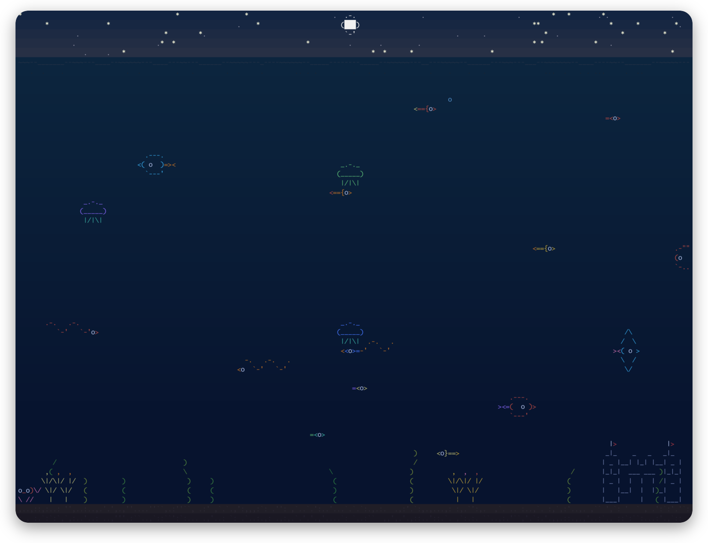
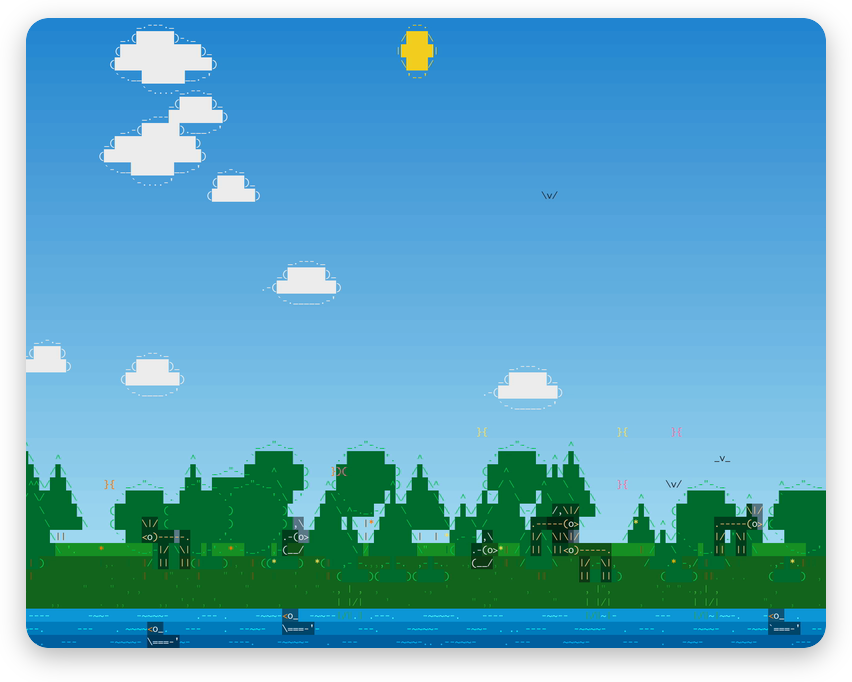
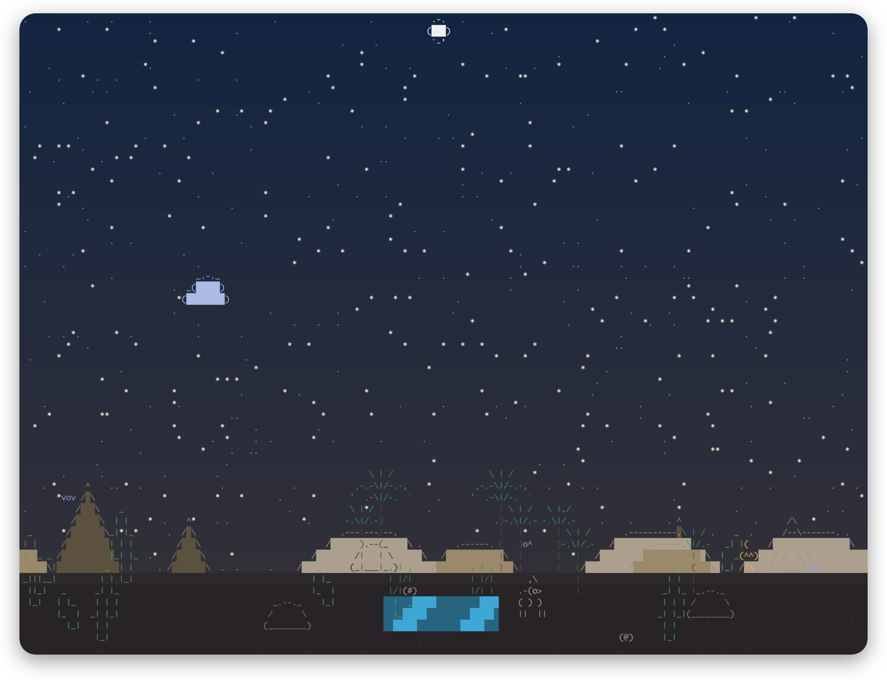
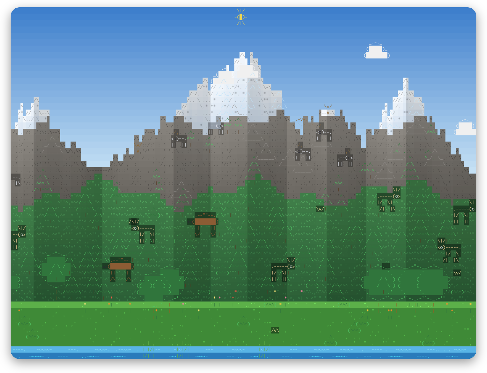
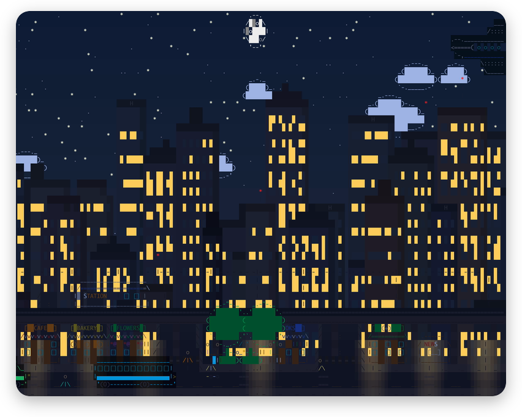
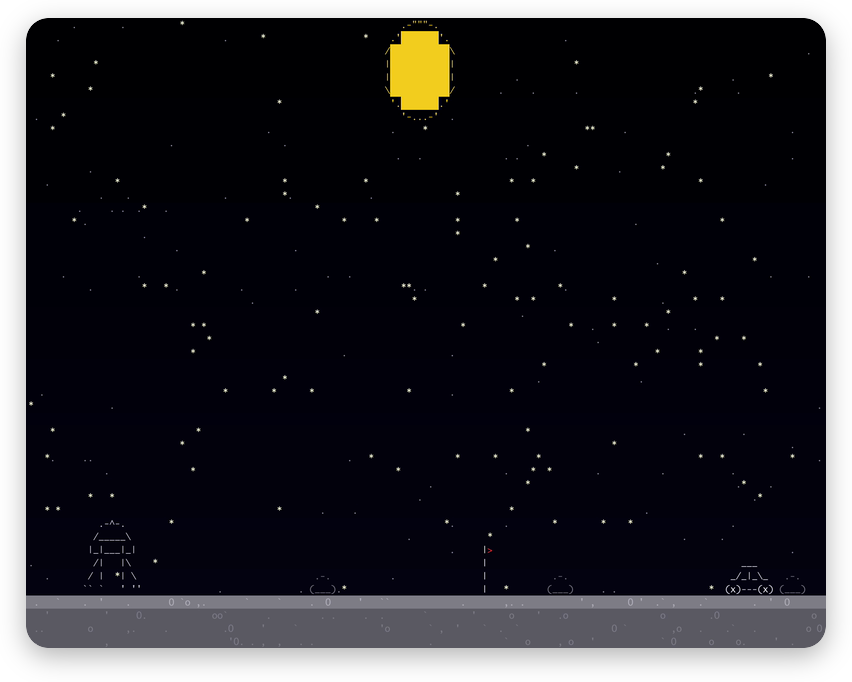

# The scenes

Left and right arrow keys (or the menu) switch between the scenes; `--scene NAME` starts in one. Each scene has

- its **inhabitants**, who live their own lives: they swim, walk, fly, hunt, sleep at night and come back in the morning,
- an **action** on `f` (in the user mode; in the cycle mode it runs by itself), a small thing you can set off whenever you like,
- two **rare events** (catastrophes) on `x` and `X` (user mode), which also turn up on their own every few minutes.

The pictures on this page are plain-text renderings made by `diorascii --dump` (see
[Using Diorascii](usage.md#looking-without-a-terminal)); in the terminal everything is in color and moves.

## Aquarium



A sea from the surface to the sandy bed: schools of fish, jellyfish, eels, crabs, a shark and a whale pass through
water and weeds, with bubbles rising and a sunken wreck on the bed.

<!-- dump: --scene aquarium --seed 3 --dump 300 --size 78x20 -->
```text
                                      /    \
                                     |      |
                                      \    /
                                       '--'
----~~~~--_______---~~---____--~~~~~~~--____---~~---______--~~~~~----_---~~~~~
    ..     .  ..    .. ..         .         .  _.-._   ..  .               ..
._,                                 <=={o>    (_____)
.'/                                            |/|\|
'               .---.
             ><=(  o )>
                `---'
                         \                 <o>=          |>             |\
                          \     \                       _|_    _   _  <o}==>
           )               )     (                     | _ |__| |_| |__| _\|
       ,  -. , .-.   .     /  ,  ,  ,                  |_|_|  ___ ___  |_|_/
      \|<o|/`-'   `-'     )  \|/\|/ |/                 | _ |  |  |  |  | _)|
       \|/(\|/            (   \|/)\|/                  |   |\/(o_o)\/__|  (|
        | ) |             )    | ( |                   |___|  // \\    |__)|
',`.:, ,`, ,:.:,'. ::'.`.'':. `,` :.:,... ::. .,:``: ', :'. ,,,`: `'`':`...:''
. .:'.`.'`...,..  .. . : ,'::,:.:. :., ..:``,`:.,.',,.``.': .,'  :.`.`,'.  .'`
```
<!-- /dump -->

- **Action `f`, feed the fish**: a clump of eight twinkling flakes of food sinks from the surface (at most 30 at once)
  and the fish swim over and eat them.
- **Kraken** (`x`): a giant sea monster lumbers across the sea bed, the water darkens to violet and it lashes out with
  tentacles at whatever it can reach, which bursts into ink. Animals out of reach survive.
- **Leaking submarine** (`X`, one time in five also on its own): a grey submarine leaves a trail of poison behind it that
  spreads until it fills the sea from top to bottom and every animal it reaches dies. The water turns sickly green; the
  cloud then lingers and thins out and the sea slowly fills with life again.

## Forest



Trees, bushes and flowers on a bank with a river, where deer, foxes, birds, butterflies and fireflies live
(butterflies and birds by day, fireflies by night).

<!-- dump: --scene forest --seed 5 --dump 200 --size 78x20 -->
```text
                              .--.
                             /    \                            _.---._
                            |      |                         _(       )_
                             \    /                       .-(           )
                              '--'                           `-._____.-'
)                                                      _.-._
 \_.-.v.-._/                                         _(     )                _
    '---'    _.-"-._                                (        }{^         _.-}{
_          .'       '. ^               _.-"-.)("-._           _.-"-._  .`
 )_^     ^(     ^    _.-"-._         .`       `.   '.      ^.`       `.      /
  / \   / \    / \ .`       `.      (           )    )    / \          )  )(/
./   \ /   \. /   (           )     (           )    )^  /   \         ).  /
\     \     \/    (           )      `.       .'   .'/ \/     \^  ^  .'  `/  ^
 \     \    /      `.       .'-,       `-._.-'\|/\|//  /      / \/ \'-,  /  /
  \     \  /         `-._.-'\ \ )      |  ,\--/,-(o>--.      /   \  \, )|*-/
| ,| (   |*) '* |      ||| |' ,  , |.,,*.-(o><o)-./ *\| *  |/.- -,\ *\)"(.- *,
   |     || ,,| | .     |     .  | |/|||(__/||\__)  |\ .| .|(     ) |   (   |
    .        ,    '  '     '     |/| ||/| ||/| | ,              .,  ,    "  "
   ---   .  -~~~~-.. . -~~-      .---- .  .-~~~~-  .. _o>-    _o>-~~~- .   -~~
---       -~~~-    -~~~~-       --       -~~~-     `-===/  `-==='--     -~~~-.
```
<!-- /dump -->

- **Action `f`, make it rain**: it rains for about 18 seconds (press again to keep it going): drops streak down and splash
  on the bank and in the river, clouds roll in and the light dims, then it clears up again.
- **Thunderstorm** (`x`): a dark cloud rolls across the sky, it pours, a lightning bolt hits the ground, the screen flashes
  twice and every animal dies.
- **Flood** (`X`): the river bursts its banks and a wall of water runs across the land and rips off every tree, bush,
  flower and animal on the bank. It recedes, and leaves mud and bare ground that is only replanted slowly.

## Desert



Dunes with cacti, an oasis (its pond is small, medium or big and lies in a different place every time, with its palms and reeds on the shore), and animals such as camels, lizards and a lion; bats and the lion come out at night.

<!-- dump: --scene desert --seed 4 --dump 250 --size 78x20 -->
```text
                               .--.
                              /    \
                             |      |
                              \    /
                               '--'

                                               \ | /          \ | /
             ^                              ,-.-\|/-.-,    ,-.-\|/-.-,
            / \                            '  .-\|/-.  `  '  .-\|/-.  `
         \ | / \                                 |              |
        -.\|/.- \                 ^              )              )
     _   / |    .----------.     / \             |              |           _
    | | /,\) /                \ / .------.       (, | ,    , | ,(  .------.| |
   _| |.-(o>                   /            \    || |/|    | |/||         _| |
   | |/(.)()>                /                \  ||/| |    |/|/||         | |
  _| |_|| )||  `` _   . ' .  , : ,     .      .                    ` .'_.--.__
  :| |  ||  || , | |_  ,..    .  :         ,` , .                  .: /   | |\
 : |_|    ..   , |_  |,   .   :,           `'   `                   '(________
      '          . |_| .     .   , : .    .,  . '  : ':  : :    .     :  : '
      :  `           '  : `    ` ,.  . ' .'  ,'  .       ,  '.  `   :   '  .
```
<!-- /dump -->

- **Action `f`, sandstorm or tornado** (a coin toss): a sandstorm blows grains across the whole screen for about 16
  seconds while the sky turns ochre. A tornado crosses the scene instead, whirls up sand and throws every animal in its
  path into the air; they land dazed and walk on. Pressing again during a tornado adds the sandstorm.
- **Sandworm** (`x`): a huge banded worm crawls through the dunes and lashes out a tongue at the animals on the ground
  ahead of it, swallowing each one it reaches (what flies is spared).
- **Poachers** (`X`): a helicopter flies after the closest animal, hovers over it and shoots down everything alive, one
  animal after the other, with tracer lines and rifle cracks. When nothing is left it leaves, and the animals return later.

## Mountains



The only scene that uses the **whole height of the terminal**: from the bottom up a meadow with a stream, a belt of forest,
bare rock with crags, and snow and ice on the peaks. The tree line and the snow line are never straight, and every run
has a different range.

| Who | Where | What they do |
|---|---|---|
| Eagles | the sky | soar across the screen and swoop down towards the rocks |
| Goats | rock and snow | leap along the ledges |
| Deer | meadow and forest | stroll about; they are the prey |
| Bears | meadow and forest | stroll about and run a deer down |
| Small birds | over forest and meadow | flit about by day |

<!-- dump: --scene mountains --seed 7 --dump 250 --size 78x24 -->
```text
                               .--.
                              /    \
                             |      |                           /,//\--\
                              \    /            -._.-"v"-._    <o)--.\**/\
                               '--'                 `-'  ^    //|/_|\_\/..\
                                                        /   //.^./\_\\/\/\_\/-
                                                   ^  /,./,\../\^.//\/. \_-._'
          .^.\                                    /:\<o.--(o>/ |\_//_\_/\_\  )
         .^^^.\^\                             /\ /  ./|/||\|^\__/_____/\ \_
           |.:/^\\                             /-,,.^^^..'//^^\.:  :/_.^.._\ .
         //.,/^^^\\-------------^------------//^  '^,|/,.^/^/^\\._.-^.^^^..,:.
   /----/. '/^^^^^\^^^''.. \' ^/^\'\:,::^',:_//^\_/^\/.^./^/^^^\'  /^\ ||. ."'
--.^.'^^,^'^' ^|^ ^'^"^^,^ ,"/^\^\\,  ^/^\"/_/^^^//^^\^^^)/^^^^^\ /^^^\   )^ .
^(^^^)/^^"^"^^ ^,''^^\^\/^\"/^^^\^\ ^'/^^^\ ^^^^//^/^\-._" ,"|(   /^\  ^  ),(
"^"^,/^/^\^""^"^^'/^\\\/^^^\^/^\^\^\',  ^  /^\ |./^\^^\  `. ^,"`./^^^\/^\'"'(
, ," ^/^^^\'"^^'"/^^^\\^^^^^/^^^\'^ '""/^\/^^^\(/^^^\      )^^"^/.^.^^\^^\ ^^`
^^"^,/^^^^^\\|/, ",|| '"".^.^"|^","",^/^^^\ |  /^^^^^\     )"''^(^^^)^^^^^\^,^
 ,^,,^.-----(o>"^,^ ,^ ^(^^^)^^ ""^,^*^.--""--..`.|      .' "^.^.*"^|,,| *^, ,
     "|/|,\| | ,   * '  *       .,   |(        )o>`-._.-''   (^^^),    ' |  ,
 "  *  /|  |\     *| "  |            ,|||^.  ||  ,,  |        .     ,  " *'
 ,  |    .    '   | .    .   ,"    _v_ \/^^).\/     .|  " '   ,          |
   ", |.,  ',    ", | ,  ".  .   "   "     (^^^) , | ,     '      ,   .      .
 -~~| |/|   ----  | |/|~~~-      --- .     -~~~- | |/|~~~-.      ---   .  -~~~
~~- |/| | --    . |/|~|~     --~-.       -~--    |/|~|~ .     ---     .-~~~~-
```
<!-- /dump -->

- **Action `f`, snowstorm**: for about 22 seconds an icy wind sweeps snow across the screen, the peaks vanish in a pale
  whiteout, the birds fall silent and the wind howls.
- **Avalanche** (`x`): high on a snowy flank the snow creaks, the slab lets go and a powder cloud rips down the mountain
  through rock and forest, burying trees, bushes and animals in its path. The swath fades after about 40 seconds.
- **Yeti** (`X`): an abnormally large, white-furred yeti climbs over the highest ridge and hunts down the animals on the
  ground, which it has to walk right up to; it roars and its steps thud. Then it goes back up and over.

## City



Skyscrapers in three rows behind a main street with sidewalks, lamps, zebra crossings, shops and a park. Cars, taxis,
buses, trucks and cyclists keep to their lane, and **the traffic follows the rush hours** (about 8:00 and 17:30). An
elevated railway with a station somewhere along it (a different place every time) carries trains, which stop at the
station (the rumble and the klack-klack of the wheels stop with them; the brakes squeal as they roll in and the air hisses as they halt): passengers get off, walk along the platform and come out into the street. Planes come in to land in the background, and on wide screens side
streets branch off the main street. The number, size and place of the trees, bushes and flowers and of the zebra
crossings change with every start, so no two cities look the same. At night the windows light up and the lamps switch on. The buildings are
generated to the height of your terminal; the scene needs a tall enough sky for all of it.

<!-- dump: --scene city --seed 6 --dump 250 --size 100x30 -->
```text
               <|=( o o o o o o o o )=====>-.
                 \_____________________,-'   \
                          /::::::/     |      |                  _.---._                           _
                         /______/       \    /                _.(       )-.__.--._
                                         '--'                (               )_   )_
                                                            (                  )    )
                                                             `-.__        __.-'__.-'
                         *                                        `-....-'
                                                                                            *
                                                                                            |
                                                                                            |
                                                                        H
- -|- - - - - - -|- - - - - - -|- - - - - - -|- - - - - - -|- - - - - - -|- - - - - - -|- - - - - -
   |             |             |             |            H|        ______________________
   |             |             |             |             |       |   S T A T I O N   |  |
   |             |             |             |             |       |______________________|
   |             |             |             |             |       /======================\
   |           * |             |             |             |      |    []|[]     [] [] |  |
   |           | |             |             |             |      |______________________|
====================================================================================================
____________________________________________________________________________________________________
   [  CAFE  ]   \[ BAKERY ]                                  [ BOOKS  ]
  /vvvvvvvvvv\  /vvvvvvvvvv\            O    /    :    \    /vvvvvvvvvv\  O.------.        O
  |[]  ..  []|  |()  ()  ()|   o  o     |   /           \   |||||  |||||  / NEWS   \       |
____________o.-----. []  []|   |__|_ *. |   /   o :     \  o|[]  []  []|  |  [__]  |o      |
[]o<[][][][/|\[][][]\_|  __|   [||||]| )|  /= =/|\= = =o=\/|\__  ||  __|  |________/|\     |
▄▄'▄ o▄▄▄*|▄|▄▄▄▄▄▄▄▄|#| _  _/_[][][] \_|  /    |      /\\/ \    _    _   |_       / \    _|   _.
--(O/|\---`-(O)---(O)-`  o #o▄o▄▄▄▄▄▄▄▄▄▄|*                        ===       ===           ===
___o-o-===  ___   ___   \|//|/|\----(O)-' ___   ___   ___   ___   _===  ___  ===_   ___   _===  ___/
_.   _    _    _..      / \ | |    _    _    _    _    _    _    _    _    _    _    _    _    _   /
```
<!-- /dump -->

- **Action `f`, call an ambulance**: it drives through the streets with its lights flashing and its siren.
- **Fire** (`x`): a skyscraper catches fire, a fire engine races in, parks in front of it and sprays it with blue water. Most
  of the time the fire is beaten and the building is renovated under scaffolding; sometimes it wins, spreads to a few more
  buildings, which burn down and are rebuilt from the rubble after a minute and a half. While the engine is there the site
  is cordoned off and traffic and people wait.
- **Monster fight** (`X`): a giant lizard and a winged monster fight with streams of fire, fire spreads from where they
  stand, everybody flees the streets, and dozens of buildings are left as ruins before the rebuilding starts.

## Moon



No atmosphere: the sky is black with its stars all the time. By lunar day a large sun stands high over a lighter grey
ground, by night the earth rises over a darker one. Rovers drive about, a flag stands by the lander, and the sound is
only what you could feel through the ground.

<!-- dump: --scene moon --seed 2 --dump 200 --hour 22 --size 78x20 -->
```text
*        .        .          .---.
      .                     /     \  .      *                  *
                           /       \
             *            |         |                                 .
     *                     \       /
            *               \     /
                             `---'             *                    .
  .    *
     *                                       .                      .     *
                           .                    .
              .-^-.                                                  .   .
            ./_____\
    .       |_|___|_|                           * |>           *
             /|   |\                 .          *.|             .      ___
         .-./ | . | \.*   .  .-.           .-.    |   *            .-_/_|_\_
        (___) `   ' ''      (___)        *(___)   |        *     *(_(x)---(x)
 O          o `'  '           '     .                   . '    `  ,        .
    '        o   ..       ,   .                        O        o` O  .
      .'       . '.  .  ,       o  ,            ,            '    '    `    oO
              O         ,           ,o                 O,    'oO      ,     o
```
<!-- /dump -->

- **Action `f`, meteor strike**: a meteorite streaks down and hits the ground, wrecks what stands there and digs a crater;
  debris drifts back down slowly in the low gravity, and dust gradually fills the crater again.
- **Alien** (`x`): an alien walks across the surface and destroys the flagpole and the rover as it passes them.
- **Big meteor** (`X`): a speck in the sky grows bigger as it falls and hits with an impact that spans the entire width of
  the screen: a flash, a crater across the full width and a wave of dust and rock to both edges.

## About the rare events

A rare event turns up every few minutes (the first after two to five minutes). It announces itself by arriving: it
crosses the scene, strikes halfway across and moves on. `x` picks like the timer does, so most of the time the first
one; `X` always summons the second one, which on its own turns up one time in five. The dead do not stay dead: animals
walk back in one by one over the next minute or so, the flagpole is planted again and the buildings are rebuilt.
Sleeping animals die unseen.

Seeing a catastrophe in the plain-text rendering, for example the avalanche, works like this:

    diorascii --dump 400 --rare 60 --seed 7 --scene mountains --size 78x24

<!-- dump: --dump 400 --rare 60 --seed 7 --scene mountains --size 78x24 -->
```text
                                    .--.           _.-._
                                   /    \        _(     )
                                  |      |      (        )        //,--\
                                   \    /                      /-/<o)--./\
                                    '--'                 ^    *o//||\_||..\
                                                        /   /*./_/\_\\/\/\_\/-
                                                   ^     /\/../\*o//\/.,\_:-,'
          .^.\                                    /:\--_/.,\_/::\_//.--(o>\.'
         .^^^.\^\                             /\ /   '/______.^./___||/\||_::.
           |.:/^\\                             /-,,  ' ..'.o.^^^.o :/_.^.._\ .
         //.,/^^^\\-------------^------------//\  '',,/, .***.|::.::^.^^^..,:.
"v"-._--/. '/^^^^^\^^^''.. \' ^/^\'\:,::^',:_/.,\_ ../'' :*..:.o:^^/^\ ||, ."'
-'\|/'^^,^'^' ^|^ ^'^"^^,^ ,"/^\^\\,  ^/^\"/______\ /:,^.:......^"/^^^\,^^'^ .
^(<o)-----."^^ ^,''^^\^\/^\"/^^^\^\ ^'/^^^\^^^^  ''",^^.o::.:*.o^^/^\ ^^""^,(
"^"^,|//^\|""^"^^'/^\\\/^^^\^/^\^\^\',  ^,^/^\"'  " ^ *o*::.*..' /^^^\/^\""'(
, ,"/|/^|\\'"^^'"/^^^\\^^^^^/^^^\'^ '""/^\/^^^\,'^^^....*:*o.o"^ .^.,/^^^\ ^^`
^^"^,/^^^^^\*^^, ",|| '"".^.^"|^","",^/^^^\ |  "''^.*..*o**o..'^.--""--.^^\^,^
 ,^,,^^"|'''|*^"^,^ ,^\|/^^^)^^ ""^,^*^^|^,"""^ ''o*o*oo:::**^.(        )o>, ,
  _v_" ,|, , | ,.-----(o>       .,   |*'  ' ,    o*.o**:*::.*(^^||,   || |  ,
 "  *   "       |/*|\|  |            ,| .^.     o..::..**o.:  . \/  , \/ *'
 ,  |    .    '  /| .|\  .   ,"        (^^^) .  :.*ooo*::.:o  ,          |
   ", |.,  ',    ", | ,  ".  .   "   "          *::.**:.*o:.o     ,   .      .
~-  | |/|--   .   |~|/|   .-~~~~-    . ---      o:*:o.:.*..*:~--       ---
    |/|-|       --|/| |  ~~~~-   .  ---       -~.o.:o*:.o*:***      ---      -
```
<!-- /dump -->
